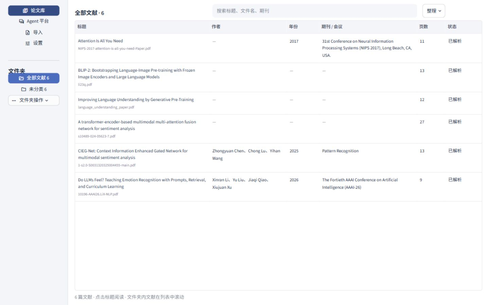
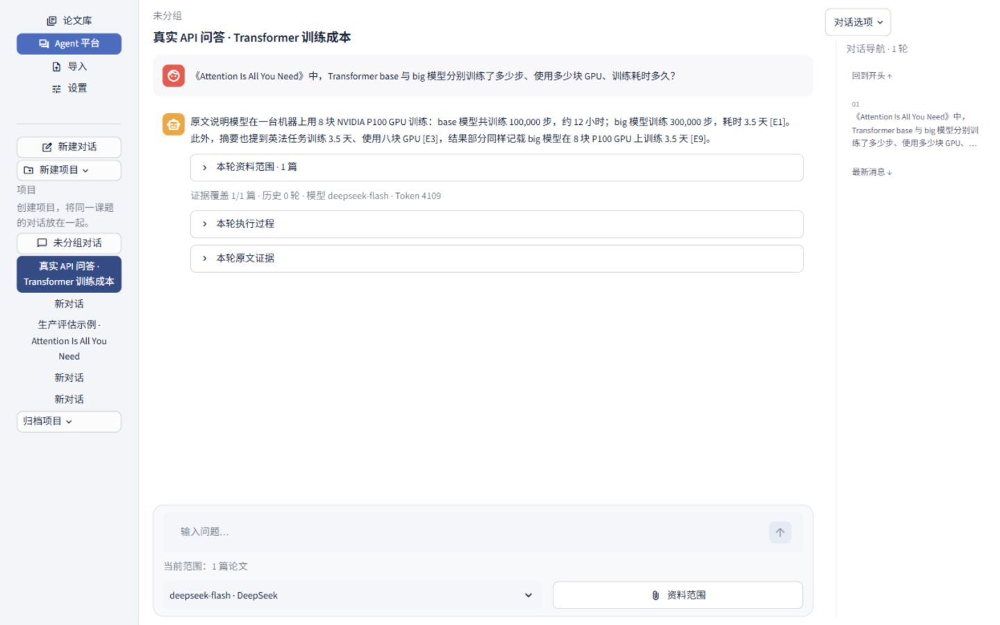

# 📚 Paper Research Agentic RAG Platform

> **本地优先的科研论文工作台**：Docling 版面级解析、BGE-M3 + BM25 混合检索、Cross-Encoder 两阶段精排、Corrective RAG（充分性判分 → 定向补检 → 联网兜底），每条结论都回指原文页码、坐标与证据编号。

[](https://python.org)
[](https://fastapi.tiangolo.com)
[](https://streamlit.io)
[](https://github.com/docling-project/docling)
[](https://huggingface.co/BAAI/bge-m3)
[](https://github.com/facebookresearch/faiss)
[](CHANGELOG.md)

---

## 📋 目录

- [项目简介](#-项目简介)
- [界面展示](#-界面展示)
- [架构](#-架构)
- [技术栈](#-技术栈)
- [评估结果](#-评估结果)
- [项目结构](#-项目结构)
- [快速开始](#-快速开始)
- [API 参考](#-api-参考)
- [部署与 CI](#-部署与-ci)
- [路线图](#-路线图)
- [文档索引](#-文档索引)
- [来源与致谢](#-来源与致谢)

---

## 🔍 项目简介

科研论文的检索增强问答有两条硬约束：**证据必须能定位回原文**，**成本必须有明确上限**。本项目围绕这两点设计，而不是把 PDF 丢进向量库就直接生成。

**关键能力：**

- **版面级解析** — Docling 在本机 CPU 上还原双栏顺序、排除重复页眉页脚，抽取标题层级、作者 / DOI / 期刊、图注、表格行与页面坐标；扫描件与加密 PDF 明确拒绝，不用空结果冒充成功
- **段落优先切分** — 单块 ≤800 字符，超长段落按句边界切、相邻块重叠一整句（<150 字符），切分版本号随索引落盘，源文变化会自动判定过期
- **混合检索一个库** — 稠密 FAISS 与稀疏 BM25 各取全局 Top 60，RRF 融合后取 60 条进精排；没有"每篇保底几条"的配额，不相干论文贡献 0 条
- **两阶段精排** — Cross-Encoder 把 60 条候选压到 10 条，中文问题先做一次只用于打分的英译（不计入调用上限，译文缺数字即回退）
- **Corrective RAG** — 判分输出 `sufficient / covered / missing / Q1`：充分则生成，不足则用 Q1 定向补检一次，补检用尽仍不完整才允许联网兜底（Tavily）
- **证据账本与引用契约** — 精排召回的全部候选都进账本并交给模型判断；服务端只接受本轮实际下发过的证据编号，表格行与被它引用的段落整段合并成一条证据
- **成本与字节边界** — 每轮计入上限的模型调用固定 3 次（判分① + 判分② + 生成），上下文预算 50,000 字节，整次请求不超过服务商 65,536 字节
- **本地优先** — 解析、向量、精排全部离线；只有提交问答时才向所选模型发送问题、有限摘要与相关片段，密钥只在服务端 `.env` 读取
- **模型常驻复用** — Docling、BGE-M3、Cross-Encoder 各自一个隔离子进程，跨任务复用已加载权重，空闲 120 / 300 / 300 秒后退出

---

## 🖼️ 界面展示

### 论文库



左侧按文件夹切换范围，右侧统一展示题名、作者、年份、期刊 / 会议、页数与解析状态；点击题名可进入同一论文的原文与解析阅读区。

### Agent 问答



截图来自一次用户明确授权的真实生产链路调用：限定《Attention Is All You Need》单篇范围，DeepSeek Flash 使用 4,109 tokens，在 48.25 秒内完成英译、混合检索、Cross-Encoder 精排、充分性判分与生成；联网关闭，回答引用论文第 7、1、8 页的三条证据。完整核对见 [README 界面展示验收记录](references/README界面展示验收记录.md)。

---

## 🏗 架构

```text
上传 PDF
   │
   ▼
[Docling 版面解析 · 本地 CPU · 常驻子进程]
  双栏顺序 / 页眉过滤 / 标题层级 / 图注 / 表格行 / 坐标
   │
   ▼
[段落优先切分 chunks v5] ──解析成功后自动排队建索引──┐
   │                                                  ├─ dense.faiss（BGE-M3, 1024d）
   │                                                  └─ bm25.json（分词/tf/df/倒排）
   ▼
用户提问 + 资料范围（单篇 / 多篇 / 文件夹 / 通用对话）
   │
   ▼
route_query        ← 显式论文范围 or 通用对话
   │
   ▼
retrieve           稠密 Top 60 + BM25 Top 60 → RRF → 60 条
translate_query    中文→英，仅用于精排（不计入调用上限）
rerank             Cross-Encoder → Top 10
   │
   ▼
grade_documents    判分① → sufficient / covered / missing / Q1
   │
   ├─ sufficient ─────────────────────────────────▶ generate
   │
   └─ 不足且有 Q1 ─▶ targeted_retrieve（定向补检，只留新证据）
                         │
                         ▼
                     grade_documents（判分②）
                         │
                         ├─ 仍不完整 ─▶ web_search（Tavily，W# 与 E# 分开）
                         ▼
                     generate（两轮证据账本并集 + 引用校验）
                         │
                         ▼
        回答 + 证据编号 [E#]/[W#] + 页码/坐标 + 真实 usage 与耗时
```

页面在同一屏里完成"论文库 ↔ 阅读区 ↔ Agent 平台"：左侧主导航，阅读区单屏双栏对照原文与解析正文，右下角翻页；Agent 侧消息内部滚动、右侧问题导航、提问过程中按 0.4 秒轮询显示当前节点。

---

## 🛠 技术栈

| 层 | 技术 | 用途 |
|---|---|---|
| 版面解析 | Docling 2.140（TableFormer） | PDF 版面、表格、图区域与阅读顺序 |
| 元数据 | pypdf / pypdfium2 + 自建规则 | 标题层级、作者、DOI、期刊 / 年份候选 |
| 嵌入模型 | BAAI/bge-m3（revision 固定） | 多语言稠密向量，1024 维，本地离线推理 |
| 稠密检索 | FAISS CPU | 每篇独立索引，指纹校验后激活 |
| 稀疏检索 | 自建 BM25（倒排 + 本轮集合 IDF） | 分词、tf、df、倒排随索引落盘 |
| 结果融合 | Reciprocal Rank Fusion | 合并稠密与稀疏全局名次 |
| 精排 | cross-encoder/ms-marco-MiniLM-L6-v2 | 60 → 10 的两阶段排序 |
| Agent 编排 | 自建状态机（`app/services/corrective_agent.py`） | 判分、定向补检、联网兜底、证据账本 |
| 生成模型 | DeepSeek Flash / Pro，兼容 Chat Completions | 严格 JSON 回答，供应商别名不偷换 |
| 联网兜底 | Tavily Search API（可替换协议） | 补检用尽后的网页片段，仅发检索问句 |
| API 层 | FastAPI 0.153 + Pydantic 2 | 本机 REST API，可信 Host 与来源校验 |
| 持久化 | SQLite（schema v6，自动增量迁移） | 论文、分类、会话、项目、连接、索引状态 |
| 前端 | Streamlit 1.66 | 论文库、阅读区、Agent 对话与设置 |
| 环境 | Python 3.12.7 + uv 0.13.3 | 锁文件安装，Windows 依赖已冻结 |
| 质量 | pytest / ruff / mypy / GitHub Actions | 288 passed / 4 skipped，模型与付费调用显式 opt-in |

---

## 📊 评估结果

### 最新：10 篇真实论文 / 51 题（生产链路）

真实解析与索引 → 中文问题英译 → Cross-Encoder 精排（交付窗口 10）→ DeepSeek Flash 判分与生成，联网关闭；51/51 题无运行错误，**126 次调用、335,442 tokens**。由正式评分器 `evaluation/metrics.py` 统一计算：

| 组 | 指标 | 结果 | 分母 / 口径 |
|---|---|---|---|
| 多级标题识别 | **Heading F1（micro）** | **94.48%** | TP 325 / FP 21 / FN 17，10 篇 471 个候选 |
| | **Level Accuracy** | **100%** | 325 / 325 个已匹配标题层级正确 |
| | Heading Macro F1（按篇平均） | 94.57% | 10 篇 |
| 混合召回与精排 | **Recall@10（宏平均）** | **98.11%** | 44 道有金标准题；金标准 micro 79/81 = 97.53%，42/44 题全中 |
| | **nDCG@10** | **0.7686** | 交付窗口 10 条 |
| | 协议 @5 对照 · Recall@5 / nDCG@5 | 83.14% / 0.7166 | 金标准 micro 65/81 |
| | 全窗口 @20 对照 · Recall@20 / nDCG@20 | 99.24% / 0.7702 | 金标准 micro 80/81 |
| Corrective RAG 回答 | **Grounded Answer Success** | **86.27%（44/51）** | 可答题 84.09%（37/44），应拒答 7/7 |
| | **Citation Precision** | **100%（107/107）** | 逐条核对引用是否支持相邻断言 |
| 范围护栏 | Scope Leakage Rate | **0.00%（0/51）** | 未越出本轮资料范围 |

**仍有 7 题失败，全部在证据层或标注歧义**：`PILOT-RL26-001`（Figure 3(c) 三个数值未进窗口）、`ADD-CMIR-002`（`W/O R(m) inv` 行被合并、模型不敢认作 R_inv 消融）、`ADD-WIS-003`（Average 70.7 未召回）、`ADD-WIS-004`（α=0.3 的句子未进窗口）、`ADD-WIS-005`（Figure 5(b) 跨栏断句）、`ADD-GPT-003`（完整模型 74.7 未召回）、`ADD-BLIP-003`（Table 6 两行未进窗口）。

详见 [数据集 v0.3 生产端到端复测](references/S3.10生产端到端复测.md)。

### 上一轮：5 篇真实论文 / 25 题

由正式评分器 `evaluation/metrics.py` 离线计算，不做模型调用：

| 组 | 指标 | 结果 | 分母 / 口径 |
|---|---|---|---|
| 多级标题识别 | **Heading F1（micro）** | **91.77%** | TP 212 / FP 22 / FN 16，5 篇 301 个候选 |
| | **Level Accuracy** | **100%** | 212 / 212 个已匹配标题层级正确 |
| | Heading Macro F1（按篇平均） | 89.75% | 5 篇 |
| 混合召回与精排 | **Recall@10（第一轮）** | **100%（22/22）** | 直接金标准 41/41，chunks v5 |
| | **nDCG@10（第一轮）** | **0.8010** | chunks v5；v4 为 0.7933 |
| | Recall@10（最后一轮后） | 100%（22/22） | 两轮账本并集，取前 10 |
| | 协议 @5 对照 · Hit@5 / nDCG@5 | 86.36% / 0.7357 | 旧窗口口径，保留可比性 |
| Corrective RAG 回答 | **Grounded Answer Success** | **84.0%（21/25）** | 25 题真实付费运行 |
| | **Citation Precision** | **100%（57/57）** | 逐条核对引用是否支持相邻断言 |
| 范围护栏 | Scope Leakage Rate | 0.00%（0/25） | 未越出本轮资料范围 |

**仍未解决的 4 题全部落在证据层，而不是生成层：**

| 题目 | 失败原因 |
|---|---|
| `ADD-CMIR-002` | Table 5 的 86.7 行被解析成 `Vanilla Framework / W/O R(m) inv`，模型不认作 R_inv 消融 |
| `ADD-PS-004` | Table 4 表注称组件消融在 MOSEI，与金标准冲突，模型拒用 38.7 行 |
| `ADD-WIS-004` | α=0.3 的默认句当时未进入证据（v5 切分后已升至第 1 名） |
| `ADD-WIS-005` | Figure 5(b) 段落被跨栏截断，续块未召回 |

3 道应拒答题全部明确说明证据不足，且未借用范围外论文。

检索两项为 chunks v5 的离线复测，回答与引用为 25 题付费运行的结果；标题识别不受切分影响。这一轮的 4 道失败题在下一轮 51 题复测中只剩 3 道（`ADD-PS-004` 已算对）。

**复现评分：**

```powershell
uv run python -m evaluation.evaluate `
  --dataset output/evaluation/benchmark-0.13.5/benchmark.json `
  --output  output/evaluation/benchmark-0.13.5/report.json
```

数据合同与标注协议见 [评估说明](evaluation/README.md)，逐项口径与窗口推导见 [S3.10 六项指标](references/S3.10六项指标.md)。

---

## 📁 项目结构

```text
Research-Agentic-RAG-Platform/
│
├── app/
│   ├── api.py                # FastAPI 装配：中间件、生命周期、/health
│   ├── main.py               # Streamlit 入口
│   ├── core/                 # 配置、错误、请求体上限、常驻模型 worker 客户端
│   ├── domain/               # 论文 / 问答 / 范围 / Agent 轨迹的数据模型
│   ├── parsing/              # Docling 解析、清洗、标题层级、图注、表格行
│   ├── metadata/             # 标题与元信息抽取规则
│   ├── retrieval/            # 切分、FAISS、BM25、RRF、精排、索引服务与缓存
│   ├── providers/            # DeepSeek / 兼容 Chat Completions / Tavily
│   ├── repositories/         # SQLite 仓储：论文、分类、会话、项目、连接、索引
│   ├── routes/               # HTTP 路由
│   ├── services/             # 导入、索引编排、Corrective Agent、回答、进度
│   └── ui_components/        # 论文库、阅读区、Agent 对话、设置等组件
│
├── evaluation/               # 六项指标评分器、数据集、回放与测量脚本
├── tests/                    # pytest 测试集：最近全量 282 passed / 4 skipped
├── scripts/                  # 模型权重下载、测试夹具、平台启动器（ps1）
├── references/               # 各切片验收记录与专项方案
├── data/                     # 运行数据：原文、解析、页面资产、SQLite（Git 忽略）
├── output/                   # 启动器日志与评估产物（Git 忽略）
├── 启动平台.cmd / 停止平台.cmd / 配置模型密钥.cmd
├── Dockerfile / docker-compose.yml
└── pyproject.toml / uv.lock / .env.example
```

上游保留目录 `ingestion/`、`embeddings/`、`vectorstore/` 与旧 `app/agent.py`、`app/rag_qa.py`、`app/ui.py` 不在当前启动路径内，检索能力已在 `app/retrieval` 中重新适配，其余按切片迁移。

---

## 🚀 快速开始

### 环境要求

- Windows 10 / 11（锁文件按 Windows 环境冻结）
- Python **3.12.7**、uv **0.13.3**
- 建议 ≥8 GB 空闲内存（BGE-M3 权重约 2.3 GB，另有 300 MB 索引缓存）
- 一次性可下载约 2.3 GB 本地权重（首次运行）

### 1. 克隆仓库

```powershell
git clone https://github.com/1BiuBiuBiu/Paper-Research-Agentic-RAG-Platform.git
cd Paper-Research-Agentic-RAG-Platform
```

### 2. 安装锁定依赖

```powershell
python -m pip install uv==0.13.3
uv sync --locked
```

### 3. 配置服务端设置

```powershell
Copy-Item .env.example .env
```

密钥只写进本机 `.env`（已 Git 忽略），页面不读取也不回显。也可以双击 **配置模型密钥.cmd**，在 Windows 密码窗口里录入内置 DeepSeek 的 Key。

### 4. 下载本地模型权重

```powershell
# 多语言嵌入模型（约 2.3 GB，支持断点续传与 SHA256 校验）
uv run python -m scripts.download_embedding

# 精排模型（数十 MB）
uv run python -m scripts.download_reranker

# 可选：预先下载 Docling TableFormer 表格权重（离线部署时必需）
uv run python -m scripts.download_tables
```

Docling 的版面模型在首次解析时自动下载；断网部署可先 `uv run docling-tools models download`，再把 `DOCLING_ARTIFACTS_PATH` 指向产物目录。

### 5. 启动

推荐双击 **启动平台.cmd**：后台拉起本机 API 与页面，健康检查通过后打开浏览器；结束用 **停止平台.cmd**（只回收本启动器创建的进程树）。

也可以手动开两个终端：

```powershell
# 终端一：单进程本机 API（不要增加 workers）
uv run uvicorn app.api:app --host 127.0.0.1 --port 8000

# 终端二：中文界面
uv run streamlit run app/main.py
```

- 工作台：<http://127.0.0.1:8501> · API 文档：<http://127.0.0.1:8000/docs>
- 两个端口都只监听本机，未引入账号系统，**不要直接暴露到公网**

### 6. 首次使用流程

1. 论文库 → 导入：多选或拖入 PDF（单批 ≤20 篇 / 200 MiB，单篇 ≤50 MiB / 500 页）
2. 解析完成后自动在后台建索引，列表显示"索引中" → "已就绪"；失败可单独重试
3. 点开论文核对元数据候选、研究图表与原页 / 解析对照
4. Agent 平台 → 新建对话 → 选资料范围（单篇 / 多篇 / 文件夹，单轮 ≤100 篇）→ 选模型 → 提问
5. 证据不足时页面会列出缺口与实际节点轨迹，可显式重试，不自动产生额外付费调用

---

## 📡 API 参考

服务默认在 `http://127.0.0.1:8000`，写操作校验 `Origin`，同时启用 `TrustedHostMiddleware` 与请求体上限。

| 分组 | 端点 |
|---|---|
| 健康与模型 | `GET /health`、`GET /models`、`GET /agent/status` |
| 论文 | `POST /documents`（兼容 `POST /ingest`）、`GET /documents`、`GET /documents/{id}`、`POST /documents/{id}/retry`、`POST /documents/{id}/reparse`、`POST /documents/{id}/refresh-extraction`、`PATCH /documents/{id}/metadata`、`PUT /documents/{id}/metric` |
| 原文与导出 | `GET /documents/{id}/original`、`GET /documents/{id}/assets/{asset}`、`GET /documents/{id}/exports/{docling_json|markdown}` |
| 索引 | `GET /documents/{id}/index`、`POST /documents/{id}/index`（手动重建 / 重试） |
| 分类 | `GET/POST /categories`、`PATCH /categories/{id}`、`POST /categories/{id}/archive|restore`、`POST /documents/move` |
| 对话与项目 | `GET/POST /conversations`、`GET/PATCH /conversations/{id}`、`POST /conversations/{id}/turns`、`GET/POST /projects`、`PATCH /projects/{id}` |
| 连接与测试 | `GET/POST /connections`、`PUT /connections/{id}`、`POST /connection-tests/draft|save`、`POST /connections/{id}/key-dialog` |
| 单篇兼容 | `POST /query`（单篇范围、无状态） |
| 进度 | `GET /agent/progress/{request_id}`、`POST /agent/scope` |

### `GET /health`

```json
{
  "status": "ok",
  "version": "0.13.8",
  "slice": "S3.10",
  "parser": "docling",
  "rag_enabled": true,
  "model_configured": true,
  "rag_ready": true,
  "rag_readiness": "需有效文档索引与可用服务端 Key；未自动验证远程服务"
}
```

### `POST /conversations/{id}/turns`

```powershell
curl.exe -X POST http://127.0.0.1:8000/conversations/替换为会话UUID/turns `
  -H "Content-Type: application/json" `
  -d '{
    "request_id": "替换为UUID",
    "expected_revision": 0,
    "question": "本文的主要实验证据是什么？",
    "scope": {"kind": "documents", "document_ids": ["替换为论文UUID"]},
    "connection_id": "deepseek",
    "model": "flash",
    "allow_web": false
  }'
```

响应包含 `answer`、逐条 `sources`（`source_id` / 页码 / 坐标 / 摘录）、`resolved_document_ids`、`model` 与 `served_model`、真实 `usage`、`latency_ms`、`context_bytes`、`rewrite_count`、`used_web`，以及节点级 `trace`。

### `POST /query`

单篇、无状态的兼容入口：`scope.ids` 必须且只能是 1 篇论文，`model` 取 `flash` / `pro`，默认 `allow_web=false`。

```powershell
curl.exe -X POST http://127.0.0.1:8000/query `
  -H "Content-Type: application/json" `
  -d '{"question":"本文的主要实验证据是什么？","scope":{"type":"documents","ids":["替换为论文UUID"]},"model":"flash"}'
```

---

## 🐳 部署与 CI

**容器**：仓库保留上游的 `Dockerfile` 与 `docker-compose.yml`，但其中仍是上游的 Python 3.11 + `requirements.txt`，与本项目锁定的 Python 3.12.7 / `uv.lock` 不一致，也未挂载本地模型权重，**不能视为可用构建**；Linux 部署留待专项切片。

**质量门禁**：`.github/workflows/evaluate.yml` 在 `windows-latest` 上执行：

```text
uv sync --locked → ruff check → ruff format --check → mypy → uv pip check → pytest
```

真实 Docling / BGE-M3 与付费模型评估单独运行，不使用占位分数。本机等价命令：

```powershell
uv run ruff check .
uv run ruff format --check .
uv run mypy
uv run pytest -q
$env:RUN_DOCLING_TESTS = '1';  uv run pytest -q -m docling     # 真实 PDF 版面
$env:RUN_EMBEDDING_TESTS = '1'; uv run pytest -q -m embedding  # 真实 BGE-M3
```

---

## 🔮 路线图

- [ ] 表格跨行 / 跨栏合并的解析修复，收敛当前 4 道证据层失败题
- [ ] 图内数值（矢量图读数）纳入证据链，替代仅图注视图
- [ ] 公式区域转 LaTeX，替换当前"原图预览 + 提取文字"
- [ ] 扫描件 OCR 与全篇兜底
- [ ] 多篇库级融合在非单篇范围上的系统评估
- [ ] 容器与跨平台（Linux）部署验证
- [ ] 本地启动器打包为免安装 exe

---

## 📚 文档索引

| 文档 | 内容 |
|---|---|
| [PRD.md](PRD.md) | 产品需求、用户故事与验收口径 |
| [架构.md](架构.md) | 模块边界、数据流与关键决策 |
| [项目状态.md](项目状态.md) | 各切片实现状态与未完成项 |
| [CHANGELOG.md](CHANGELOG.md) | 逐版本变更、验证证据与提交哈希 |
| [评估说明](evaluation/README.md) | 数据集合同、评分命令与指标定义 |
| [S3.10 六项指标](references/S3.10六项指标.md) | 正式指标口径、窗口推导与失败分析 |
| [S3.10 切分 v5](references/S3.10切分v5.md) | 段落优先切分与检索复测 |
| [S3.10 端到端复测](references/S3.10端到端复测.md) | 25 题真实运行记录 |
| [S3.10 模型常驻](references/S3.10模型常驻验收记录.md) | 常驻 worker 冷热对比 |
| [PDF 结构解析方案](references/论文PDF结构解析方案.md) | 版面、图注、表格的解析策略 |
| [DeepSeek 接入说明](references/DeepSeek接入说明.md) | 服务商配置、密钥与错误码 |
| [功能迁移清单](references/功能迁移清单.md) | 上游模块迁移与未迁移项 |

---

## 👤 来源与致谢

本项目从 [Enterprise-Agentic-RAG-Platform](https://github.com/ara-5/Enterprise-Agentic-RAG-Platform) 的固定提交 `f165bf62ca6cf2df84ce0829f470823bdfa08bdd` 迁移而来，保留上游 Git 历史与未迁移模块，在此基础上重建了论文解析、库级混合检索、证据账本与本地工作台。

- 维护者：[@1BiuBiuBiu](https://github.com/1BiuBiuBiu)
- 联系方式：通过 [Issues](https://github.com/1BiuBiuBiu/Paper-Research-Agentic-RAG-Platform/issues) 反馈
- 依赖与模型：Docling（MIT）、BAAI/bge-m3、cross-encoder/ms-marco-MiniLM-L6-v2、FAISS、rank-bm25、FastAPI、Streamlit
